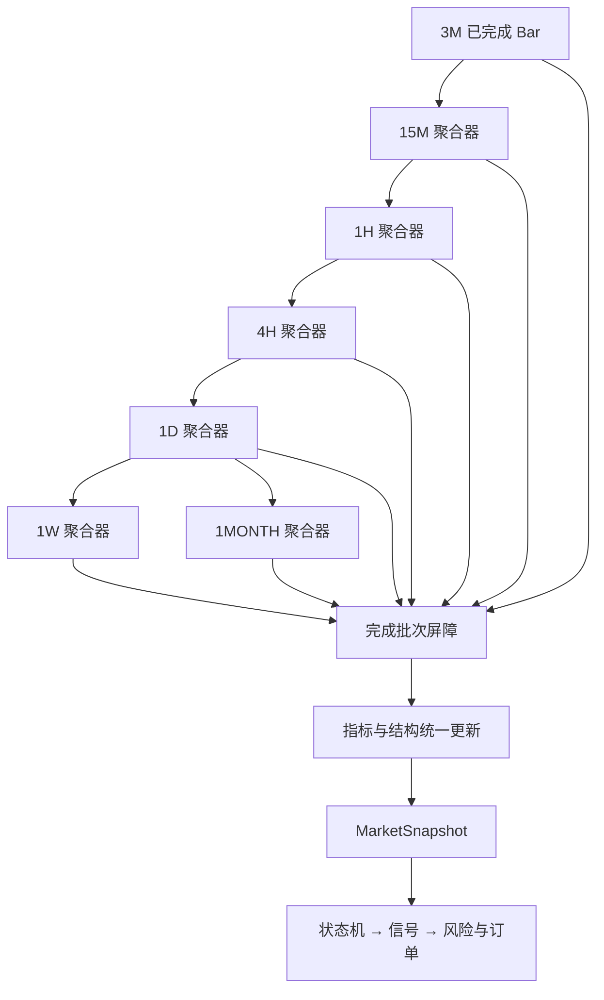

# SPEC-V148-03｜时间与 Bar 处理规范

> **文档状态：** V1.4.8-TIME-R1 修订候选（REVIEW_CANDIDATE）。本章拟替换 V1.4.8 第 03 章；跨章节未确认项不得自动视为已冻结规则。

## 1. 文档元数据

- 文档 ID：`SPEC-V148-03`（章节 ID，不是 REQ ID）
- 基线：V1.4.8 扩充版；修订标识：`TIME-R1`
- 目标：ETH-USDT-SWAP 七周期的时间、完成 Bar、聚合、因果性及确定性事件契约。
- 适用周期：`3M, 15M, 1H, 4H, 1D, 1W, 1MONTH`。
- 本章为设计规格，未声称已完成 NautilusTrader 集成测试或回测验证。

## 2. 时间标准与周期边界

### 2.1 UTC 和区间

所有内部时间必须为带 UTC 时区语义的时间戳，序列化统一为 Unix 纳秒整数 `int64`（UTC epoch ns）；显示可转为 ISO 8601 `Z`。禁止使用无时区 datetime 或混合秒/毫秒/纳秒进行比较。若外部数据精度低于 ns，必须明确单位并无损转换，不得假设时间戳代表收盘已可用。

Bar 的覆盖区间为 **`[open_time, close_time)`**。时间戳恰好等于 `close_time` 的成交/行情事件属于下一个 Bar；不属于上一 Bar。`close_time` 是右边界（exclusive），不是最后一笔成交的时间。内部的 Bar 完成事件以该右边界为逻辑时间，但另存真实 `available_at` / `received_at`。

- `3M`、`15M`、`1H`、`4H`、`1D`：从 UTC 00:00 的整数周期边界开始。
- `1W`：周一 00:00 UTC 至下一周一 00:00 UTC。
- `1MONTH`：自然月 1 日 00:00 UTC 至下一自然月 1 日 00:00 UTC；不得使用固定 30 天或固定秒数。
- 月度 ATR(14) 按 **14 根已完成自然月 Bar** 计算 True Range，遵守第 04 章的连续有效输入、暖机与无效标记；不得以天数换算 ATR 周期。

### 2.2 时钟与延迟

- `event_time`：市场事件所属 UTC 时间；`received_at`：本地实际收到事件的 UTC 时间；`available_at`：数据通过最终性、完整性及时间门禁后允许策略读取的最早时间。
- 以可校准 UTC 时钟执行本地门禁；时钟不可信或偏差超过配置阈值时停止放行新的完成 Bar，产生审计告警。不能通过回调执行时间倒推历史数据早已可用。
- `available_at >= close_time`，且不得早于最终性证明及完整性证明实际可用时间。历史回测必须使用可复现的可用时间模型；无该信息时须显式声明延迟假设。

## 3. BarIdentity 与数据契约

```python
@dataclass(frozen=True)
class BarIdentity:
    instrument_id: str
    timeframe: str
    open_time: datetime       # UTC, inclusive
    close_time: datetime      # UTC, exclusive
    is_closed: bool
    source: str
    sequence: int
```

上述字段保留兼容。实现必须另外维护 `source_bar_id`、`received_at`、`available_at`、`finality_evidence`、`completeness_status`、`revision_id` 和 `config_version`（可放在 BarEnvelope 中，不强制修改上述 dataclass）。`source_bar_id` 唯一标识来源 Bar；相同来源事件重复到达必须幂等。

### 3.1 `source` 枚举

| 值 | 含义 |
|---|---|
| `EXCHANGE_FINAL` | 交易所原生 Bar，带可信最终完成标记 |
| `LOCAL_AGGREGATED` | 由本系统对完整、已完成子 Bar 聚合 |
| `HISTORICAL_VERIFIED` | 历史导入且完整性、最终性已校验的 Bar |

不得将未完成行情标记为以上任意一种完成来源。其他来源需通过配置注册其最终性证明和时间语义，否则隔离。`source` 是溯源类型，不代表行情数据的优先级或自动可信。

### 3.2 `sequence` 语义

- 按 `(instrument_id, timeframe)` 独立维护 **严格递增** 的已接受完成 Bar 序号；同一流首个接受的完成 Bar 序号为 `1`，之后每接受一个新完成 Bar 加一。
- 重复事件不增加序号；拒绝或隔离的 Bar 不占用序号；不能使用网络到达顺序给乱序数据重新编号。
- `sequence` 只表示本地接受次序，不是交易所原生序号，不是跨周期全局排序键，也不替代 `open_time` 连续性校验。
- 重启必须持久化并恢复该流的序号和最后完成边界；全量回放从同一明确起点重新编号，才可比较序号一致性。对任意截断窗口回放应比较时间键与内容，不能要求绝对序号相同。
- 同一 `(instrument_id,timeframe,open_time,close_time)` 不得有两个不同的已接受内容版本；迟到修订需隔离并走显式重建流程，不能静默覆盖已用于策略的历史 Bar。

## 4. 完成 Bar 判定与数据连续性

### 4.1 双重完成门禁

`is_closed = true` **当且仅当**：

1. **最终性条件**：交易所原生 Bar 有明确 final/confirm 标志；或本地聚合的全部预期子 Bar 均已最终确认；或历史导入通过来源定义的最终性验证。无最终性证明的推送不得仅凭本地时间推定完成。
2. **时间条件**：可信本地 UTC 时钟 `now_utc >= close_time + finality_guard`；`finality_guard >= 0`，用于处理时钟偏差及来源确认延迟，具体值为配置项。
3. **完整性条件**：Bar 时间区间合法、OHLCV 基本约束成立，且聚合所需子 Bar 覆盖无缺口、无重复、无重叠；来源内容已通过去重/排序/一致性校验。

三个条件都成立才产生一次 `BarFinalized`；不满足则保留 `PENDING` 或标记 `INCOMPLETE/QUARANTINED`，不得交给策略。`is_closed` 是通过门禁后的状态，不应直接信任外部输入布尔值。历史数据可使用确定性的模拟时钟和来源最终性证明，但不得使用未来数据补齐当时尚未可用的信号。

### 4.2 缺失、乱序与迟到

- 重复相同 Bar：幂等忽略；相同身份不同内容：冲突隔离。
- 乱序到达：在尚未发布对应时间批次前，可进入有界重排序缓存；已发布批次之后的迟到数据不得追溯修改交易决策，需隔离并触发数据修复/重放流程。
- 缺失 Bar：**不得合成**；标记数据连续性不完整，并阻止所有依赖该区间的指标、结构、状态、信号和回测验收。缺口修复须通过明确的历史回补、完整性验证和重新计算；不能假设无成交就等于合法空 Bar。
- 同一时间边界的批次必须等待所需输入均完成或明确进入缺口/超时状态。超时不得被解释为完整完成；超时可触发暂停/隔离，不可强制生成缺失 Bar。

## 5. 周期聚合 DAG 与递归规则

### 5.1 唯一规范聚合链



- 3M 是本规范的**最小聚合输入周期**；`3M → 15M` 每 5 根，`15M → 1H` 每 4 根，`1H → 4H` 每 4 根，`4H → 1D` 每 6 根。
- `1D → 1W` 按 UTC 周历收集 7 根日 Bar；`1D → 1MONTH` 按当月日历收集 28/29/30/31 根日 Bar。**周与月是 1D 的两个并行分支，禁止 1W → 1MONTH 或 1MONTH → 1W。**
- 每个父 Bar 的 `open=首子Bar.open`、`close=末子Bar.close`、`high=max(high)`、`low=min(low)`、`volume=sum(volume)`，`open_price=首子Bar.open_price`、`close_price=末子Bar.close_price`；必须覆盖父区间恰好一次且按时间连续。对其他聚合字段需有独立、明确的合成公式，不能默认为简单平均。
- 只在**父周期右边界已到且所有子 Bar 已完成**时发布父 Bar。新发布的父 Bar 递归送入其父节点；否则仅维护未完成聚合缓冲。月、周的分支各自独立维护状态。
- 若系统使用交易所原生高周期 Bar，必须明确选择 `DIRECT_VERIFIED` 输入模式并验证时间边界及一致性；**同一周期不得同时把原生 Bar 与本地聚合 Bar 双重计入**。本修订版默认 `RECURSIVE_3M`，切换模式需重建/验收，不得运行中静默切换。

### 5.2 多周期同边界完成的处理顺序

对每个 `close_time = T` 建立 `CompletionBatch(T)`。先按 DAG **自下而上**收集、聚合、验证所有能在 T 完成的 Bar；达到完整批次屏障后，才允许策略读取。批次内的策略阶段按 **自上而下**固定顺序：

`1MONTH → 1W → 1D → 4H → 1H → 15M → 3M`。

这里的顺序仅适用于本次已完成的周期，不得重复更新未完成周期；未完成周期的历史状态可被 Snapshot 引用，但必须携带其最后完成时间与版本。

| 阶段 | 操作 | 批次约束 |
|---|---|---|
| 1 | 收集 3M 最终 Bar，递归聚合至所有到期父周期 | 不运行策略 |
| 2 | 校验数据完整性并关闭 `CompletionBatch(T)` | 失败则阻断受影响路径 |
| 3 | 按固定周期顺序更新 ATR/SMA/ZigZag/Swing/Zone | 仅更新 T 已完成周期 |
| 4 | 一次性生成不可变 `MarketSnapshot(T)` | 引用同批次更新后版本 |
| 5 | 执行 MarketContext、4H/1H Setup 等状态机 | 同一 Snapshot，确定性顺序 |
| 6 | 评估 15M Signal、3M Execution | 3M 不独立创建策略信号 |
| 7 | 生成风险/订单意图，交执行门禁 | 不在 T 时刻回填成交 |

**原子性边界**：同一个批次的所有已完成周期数据更新必须先提交，策略才能看到新快照；同批次策略状态、信号和订单意图应按事件日志确定性提交。出现部分失败时不得对外发布半更新 Snapshot；应暂停该批次、记录错误并从最近一致检查点重放。该原子性是策略可见性与可重放性要求，不意味着网络订单发送可数据库式回滚。

**跨批次排序**：按 `T` 严格递增处理，不能因某周期数据先到而跳过尚未关闭的更早必需批次。若迟到导致等待，采用隔离/暂停机制，不以未来批次数据补充过去 Snapshot。

## 6. 因果性与订单时间门禁

- 所有策略状态只能使用已完成、已可用的 Bar。禁止用未完成 Bar 产生 SwingPoint、确认 N 结构、更新趋势状态或产生交易信号。
- 例如 `[12:00,12:15)` 的 15M Bar 在 12:15 达到逻辑右边界，但信号只能在最终性、时间与完整性门禁通过后生成。`[12:15,12:18)` 的 3M Bar 不能作为 12:15 时已知的完整执行 Bar。
- 定义 `decision_at >= max(本次依赖输入的 available_at)`；订单意图 `created_at >= decision_at`；实际可提交时刻 `submit_not_before = created_at + min_latency`，其中 `min_latency >= 0` 是可配置的因果性下界。模拟交易必须在满足该下界且出现合法后续可执行事件后才能成交；即使 `min_latency=0`，也不得使用已经过去的 T 开盘价格成交。
- `min_latency` 的具体数值、滑点、订单类型、撮合触价、越价和执行价格模型依第 13/15 章执行规范统一核对；本章只定义时间下界，不擅自覆盖订单执行规则。
- 同批次新 15M Signal 与 3M Execution 的关系必须遵守第 12 章：不得用本批次结束前已经发生的 3M 价格行为，倒过来确认刚刚生成的信号。除非第 12 章明确允许并证明因果性，否则新 Signal 的执行确认从后续 3M 完成事件开始。

## 7. 指标与状态的可用性

- ATR 为 Wilder ATR(14)，SMA 为 SMA(22)；每周期独立实例、独立暖机、独立连续性标记，遵守第 04 章。
- 1MONTH 的 14 根 ATR 输入是 14 根连续完成的自然月 Bar；月初仅可引用上一个完整月的指标，不得读取当月未完成 OHLC。
- 断档、无效 ATR 或数据不完整时，不得用占位值继续进行 ATR 倍数判定。跨周期 MarketSnapshot 必须记录每个周期的 `last_closed_at`、`data_valid`、`indicator_ready`、`state_version`、`source_bar_id`。

## 8. 审计、持久化与重放

每个 `CompletionBatch` 必须记录：`batch_id`（由 instrument + T 确定性生成）、`close_time`、各周期输入 Bar IDs、各来源 finality evidence、各输入 available_at、输出 Bar IDs、处理周期顺序、指标/结构版本、Snapshot ID、决策时间、订单意图 ID、配置版本、状态（PENDING/COMMITTED/QUARANTINED）。

持久化检查点至少包括：各周期最后完成边界、sequence、未完成父周期聚合缓冲、去重键、指标/结构状态、已提交批次 ID、订单意图去重键。重启不得重复提交同一信号或订单。批量、增量、历史重放在**相同输入、相同配置、相同可用时间模型**下必须得到相同 Bar、Snapshot、Signal 和订单意图；不要求真实网络成交完全一致。

## 9. 参数表

| 参数 | 初始规则/默认值 | 约束 | 类别 |
|---|---|---|---|
| `base_timeframe` | `3M` | 固定聚合入口 | FIXED |
| `aggregation_mode` | `RECURSIVE_3M` | 禁止混用输入源 | FIXED（本版） |
| `timezone` | `UTC` | 所有内部时间统一 | FIXED |
| `timestamp_unit` | `ns` | int64 UTC epoch | FIXED |
| `week_start` | Monday 00:00 UTC | ISO 周边界 | FIXED |
| `month_boundary` | 自然月 UTC | 不得固定秒数 | FIXED |
| `finality_guard` | `0 ns` 初始研究值 | >= 0；真实部署需验证时钟/来源延迟 | RESEARCH |
| `max_clock_skew` | 待标定 | >= 0；超限停止放行 | OPEN_DECISION |
| `reorder_buffer_limit` | 待标定 | 有界；不能允许已发布批次被改写 | OPEN_DECISION |
| `batch_wait_timeout` | 待标定 | 超时隔离，不伪造 Bar | OPEN_DECISION |
| `min_latency` | 待第 13/15 章统一 | >= 0；不得回填成交 | CROSS_CHAPTER |
| `atr_period` | 14 | Wilder，连续有效输入 | FIXED |
| `sma_period` | 22 | 连续有效 Close | FIXED |

未确定参数不得由实现者任意选择并作为已验证的生产参数；必须在配置中显式赋值并留审计记录，未满足必要门禁时禁止生产运行。

## 10. 验收要求与黄金样本

1. **周期边界**：验证 3M/15M/1H/4H/1D/1W/1MONTH UTC 对齐；覆盖跨年、闰年、28/29/30/31 天及跨月周。
2. **半开区间**：时间戳恰等于 T 的事件归属下一 Bar，T-1ns 归属上一 Bar；验证外部毫秒/微秒转换。
3. **递归聚合**：5×3M→15M、4×15M→1H、4×1H→4H、6×4H→1D；周/月从 1D 独立分支生成，OHLCV 与时间边界正确。
4. **同时完成**：周一 00:00 UTC 及月初恰逢周一时，验证所有到期周期先完成聚合、再按 1MONTH→1W→1D→4H→1H→15M→3M 更新。
5. **双门禁**：仅本地时间达到 T、仅交易所 final、子 Bar 缺失三种情况均不得放行；三个条件满足后恰好一次放行。
6. **缺口/乱序**：重复幂等、冲突隔离、迟到不能改写历史、缺口阻断受影响路径、回补重建可复现。
7. **sequence**：按 `(instrument,timeframe)` 独立递增；重启续号；重复不占号；窗口重放按明确起点比较。
8. **Snapshot 原子性**：故障注入在聚合、指标、Snapshot、状态机各阶段，不出现半更新的可见 Snapshot 或重复订单意图。
9. **因果性**：15M 在 T 完成生成的 Signal 不得利用 T 之前的 3M 完成事件确认执行，也不得在 T 开盘价成交。
10. **可用时间**：不同接收延迟、finality_guard、min_latency 下验证决策时间与可执行时间下界。
11. **月 ATR**：不足连续 14 根完整自然月时不可用；月内不使用未完成月数据。
12. **一致性**：同输入/配置/可用时间模型的增量、批量、回放输出哈希一致；异常时审计记录足够定位。

每项必须有断言、黄金样本或事件日志证据；冻结门槛按第 07、21、24 章执行。

## 11. 依赖与交叉引用

- [04](./04-指标与 ZigZag.md)：ATR/SMA、Swing 更新与确认时序。
- [05](./05-Swing 结构与保护点.md)、[06](./06-Zone 支撑阻力区域.md)：已完成 Bar 与结构状态。
- [07](./07-数据标注与黄金样本.md)：黄金样本。
- [08](./08-宏观趋势状态机.md)、[09](./09-4H 与 1H 状态机.md)、[10](./10-Setup 生命周期.md)、[11](./11-15M 信号系统.md)、[12](./12-3M 执行确认.md)：快照消费与执行确认。
- [13](./13-订单与成交执行规范.md)、[15](./15-止损与可执行价格.md)：订单提交、撮合、滑点。
- [20](./20-核心数据结构.md)、[21](./21-回测与验证规范.md)、[24](./24-冻结条件.md)：契约、回测、冻结。
- 项目需求 ID 使用 `REQ-NNN`，不得与 `SPEC-V148-NN` 混用。

## 12. 未决项与跨章节一致性

1. `max_clock_skew`、`reorder_buffer_limit`、`batch_wait_timeout` 的生产数值需结合 OKX 数据延迟、运行时钟与数据修复策略确定。
2. 本章新增 `available_at`、`finality_evidence`、`CompletionBatch`、`MarketSnapshot` 字段需与第 20 章数据模型对齐。
3. `min_latency` 和新 15M Signal 对 3M 执行确认的生效边界需与第 12、13、15 章逐条核对。
4. `RECURSIVE_3M` 模式对 1D/1W/1MONTH 的历史数据暖机成本及交易所原生 Bar 一致性须回测验证。
5. 实盘若无法取得可信交易所最终性证明，须先批准替代的完整性/最终性协议；**不得**自动降级为仅靠本地时钟关 Bar。

这些项目应登记至 `OPEN_DECISIONS.md`；本文件不代表已实际更新该索引。

## 13. 修订记录

| 修订项 | 结果 |
|---|---|
| 聚合链与触发条件 | 定义 3M→15M→1H→4H→1D，再分叉到 1W/1MONTH |
| `is_closed` | 最终性、时间、完整性三门禁 |
| `sequence` | `(instrument_id,timeframe)` 独立递增，重启恢复 |
| `source` | 三类来源枚举与验证规则 |
| 订单时间 | 定义 `decision_at`、`submit_not_before`、`min_latency` |
| 半开区间 | UTC 纳秒、右边界归属下一 Bar |
| 自然月 | 自然月完成与 ATR 输入规则 |
| 七阶段原子性 | 完成批次屏障、快照原子提交、故障重放 |
| 额外修复 | 分支聚合、重复输入、缺口、迟到修订、时间可用性、数据源混用、检查点、同批次新信号因果性 |
